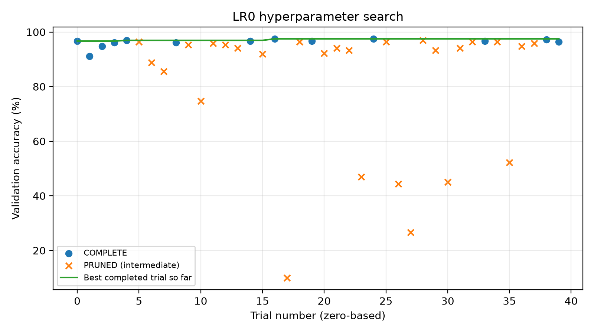
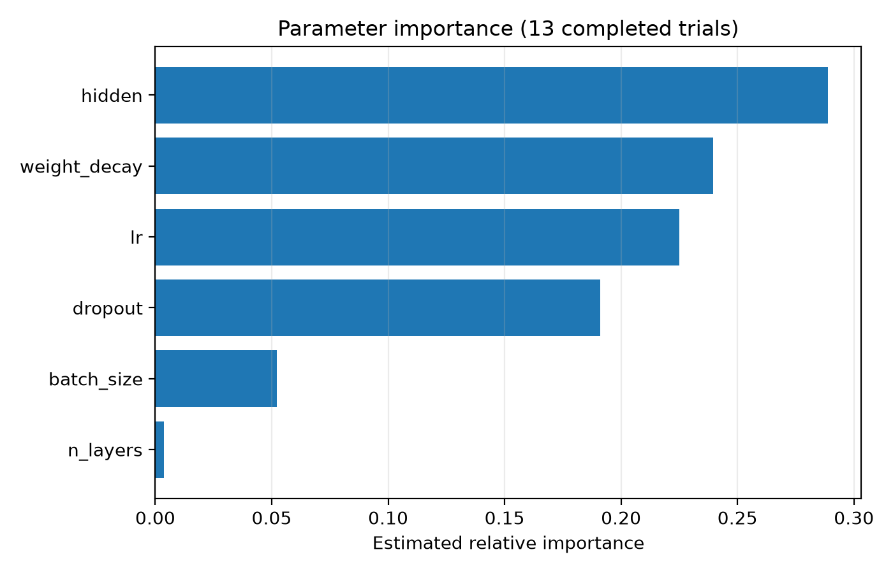

ЛР0 · Воспроизводимый эксперимент

Подбор гиперпараметров MLP: превышает ли улучшение случайный разброс?

Проверяемая гипотеза: настройка должна давать выигрыш, превышающий разброс базовой модели по seed. Исходный прогноз хранится отдельно в prediction.md; этот итоговый текст составлен после экспериментов и не заменяет исходный прогноз. Численный прогноз здесь не приписывается исходному документу, копия которого не предоставлена для подготовки отчёта.

1. Метод и воспроизводимость

Данные load_digits: 1797 изображений 8×8, 10 классов; признаки разделены на 16. Стратифицированное разбиение: train 1077, val 360, test 360; отдельный split_seed=0. Обучение: MLP с ReLU и dropout, Adam, cross-entropy, 30 эпох, CPU, один поток. train.py сохраняет конфигурацию, metadata.json, историю, предсказания и метрики; Optuna вызывает ту же процедуру обучения. Итоговые метрики пересчитываются из predictions.csv. Контроль цепочки: конфигурация + Git + SHA-256 → train.py → runs/ и MLflow → скрипты анализа → таблицы и графики.

Разбиение SHA-256: 6292b3d0d41cf7b302d5f7afbfbc93b712e8f74fc19b4ab62b67186417946cae. Исходный коммит финальной серии: 27bfd7275d7ae521b07c60732ee341bc96f00f16. Python 3.11.9; версии библиотек сохранены в metadata.json и final_statistics.json.

Ограничение протокола: до формальной серии были разведочные запуски, включая просмотр test при другом разбиении. Они исключены из таблиц; полную слепоту ко всему набору данных утверждать нельзя. В формальном поиске test не использовался, best.yaml заморожен до десяти финальных запусков; после их оценки конфигурация не перенастраивалась.

2. Эксперимент 1: разброс базовой модели

| Seed | Верно / N | Val accuracy | Время, с |
| --- | --- | --- | --- |
| 1 | 346 / 360 | 96.1111% | 0.335436 |
| 2 | 344 / 360 | 95.5556% | 0.279118 |
| 3 | 343 / 360 | 95.2778% | 0.282043 |
| 4 | 343 / 360 | 95.2778% | 0.280760 |
| 5 | 344 / 360 | 95.5556% | 0.319595 |

Источник: серия base_seeds, seeds 1–5; reports/source_data/base_seeds_summary.csv. Код: summarize_base.py. Каждая строка - 360 изображений val; run_id и коммиты перечислены в CSV.

Минимум / медиана / максимум: 95.2778% / 95.5556% / 96.1111%. Размах: 0.8333 п.п. Два формальных запуска seed=0 дали одинаковые метрики (без времени) и предсказания, val=95.0000%. Для seed=2 относительно seed=1 исправлен 1 ответ, испорчено 3 из 360: Δ=-0.5556 п.п.

Время базовой серии: минимум / медиана / максимум = 0.279118 / 0.282043 / 0.335436 с.

Источники повторяемости: runs/20261024_133833_264af668a0fd и runs/20261024_133936_81ffb4c2f6fd; попарный анализ: seed1_vs_seed2.csv, summarize_base.py. Время - сумма интервалов обучения и валидации по эпохам, без настройки, записи файлов и MLflow.

---

3. Эксперимент 2: поиск Optuna

Последовательный TPE (sampler seed=42), MedianPruner (startup=5, warmup=5), seed обучения=0. Study lr0_search сохранена в optuna.db: первые 10 trial, затем продолжение до 40. Возобновление сохраняет историю trial, но повторная инициализация sampler не гарантирует последовательность предложений непрерывного поиска.

Пространство: lr 10⁻⁴–10⁻¹ (log); n_layers 1–3; hidden 32–512 (int, log); dropout 0–0.5; weight_decay 10⁻⁶–10⁻² (log); batch_size ∈ {32, 64, 128}. Цель - accuracy на val после последней эпохи, не максимум по эпохам.

Всего 40 trial: COMPLETE=13, PRUNED=27, FAIL=0. Выполнено 535 / 1200 эпох; не выполнено 665 (55.42%). Измерено 16.186867 с обучения и валидации. Оценка экономии: 17.443898 с; для каждого прерванного trial оставшиеся эпохи умножены на его среднее время эпохи. Это не прямой замер поиска без прунинга.

Рис. 1. Точность на val по trial (N=360); PRUNED показывает промежуточную, а не финальную оценку. Линия - лучший завершённый trial. Источник: lr0_search, optuna.db; код: analyze_search.py. Сводка: search_analysis.json.

Рис. 2. Относительная важность параметров по 13 COMPLETE trial (fANOVA); оценка ограничена малой выборкой и не является причинным эффектом. Источник: lr0_search, optuna.db; код: analyze_search.py. Сводка: search_analysis.json.

Лучший trial №16 (нумерация с нуля): val=97.5000%. Выбраны n_layers=2, hidden=476, dropout=0.491257, lr=0.01176934, weight_decay=2.7897021e-05, batch_size=64. Точные значения: configs/best.yaml.

---

4. Эксперимент 3: парное сравнение

После замораживания конфигурации выполнены final_base и final_best с новыми seeds 101–105: десять запусков при общих условиях и коммите. Веса обучаются только на train=1077; val не присоединяется. Оценка test включена только в финальной формальной серии. Δ = best − base; п.п. - процентные пункты.

| Seed | Base test | Best test | Δ val, п.п. | Δ test, п.п. |
| --- | --- | --- | --- | --- |
| 101 | 95.2778% | 97.5000% | +1.9444 | +2.2222 |
| 102 | 94.7222% | 96.6667% | +1.9444 | +1.9444 |
| 103 | 93.8889% | 96.3889% | +0.8333 | +2.5000 |
| 104 | 94.7222% | 96.9444% | +2.2222 | +2.2222 |
| 105 | 95.2778% | 96.3889% | +1.6667 | +1.1111 |

Источник: final_base / final_best, seeds 101–105; paired_comparison.csv и final_runs.csv. Каждая accuracy имеет знаменатель 360; код: summarize_final.py. Полные run_id сохранены в final_runs.csv.

Δ val: минимум / медиана / максимум = +0.8333 / +1.9444 / +2.2222 п.п.; Δ test = +1.1111 / +2.2222 / +2.5000 п.п. Все пять test-разностей положительны и превышают размах базовой серии 0.8333 п.п. По критерию задания улучшение устойчиво в исследованных условиях.

Лучшая поисковая val accuracy: 97.5000%; средняя val accuracy выбранной конфигурации на новых seed: 97.1111%; средняя test accuracy: 96.7778%. Снижение совместимо со смещением отбора и различиями seed / выборок; эти причины данным опытом отдельно не измерены.

На test исправлено 51, испорчено 15 ответов суммарно по пяти seed. Чистый выигрыш 36 / 1800 = 2.0000 п.п. Это 1800 парных наблюдений на тех же 360 уникальных изображениях, а не 1800 независимых изображений.

| Seed | Индекс | Класс | Base | Best | Исход |
| --- | --- | --- | --- | --- | --- |
| 101 | 170 | 8 | 1 | 8 | Исправлено |
| 101 | 1242 | 1 | 1 | 9 | Испорчено |

Источник: paired_predictions.csv, split=test, seed=101; по одной паре предсказаний в строке. Код: summarize_final.py; выбор примеров: build_report.py. Эти случаи показывают изменение ошибок, но без анализа изображения не объясняют внутреннюю причину решения сети.

5. Вывод, ограничения и кодогенерация

Подбор улучшил итоговую точность больше наблюдаемого шума от seed. Вывод относится к этому фиксированному разбиению digits, MLP и пяти новым seed; это не тест статистической значимости и не гарантия на других данных. Важность параметров и экономия времени интерпретируются с оговорками выше.

С помощью ChatGPT подготовлены и исправлены код каркаса, поиска, анализа, документация и этот отчёт. Пользователь выполнил команды локально. Проверены компиляция, границы lr, отказ при dirty Git, восстановление метрик из сохранённых предсказаний, повторяемость seed=0, различия seed=1, полнота серий, единые условия, 40 сохранённых trial и соответствие таблиц CSV/JSON. Архивирование и упаковка выполняются отдельно и не являются новыми экспериментами.

Источники: задание «Лабораторная работа 0» (§3–5), «Общие правила» (§6–8); исходные CSV/JSON в reports/source_data, графики в reports/figures. Рендер и все численные вставки: build_report.py. Исходный прогноз: prediction.md (проверить соответствие формулировок перед сдачей).
